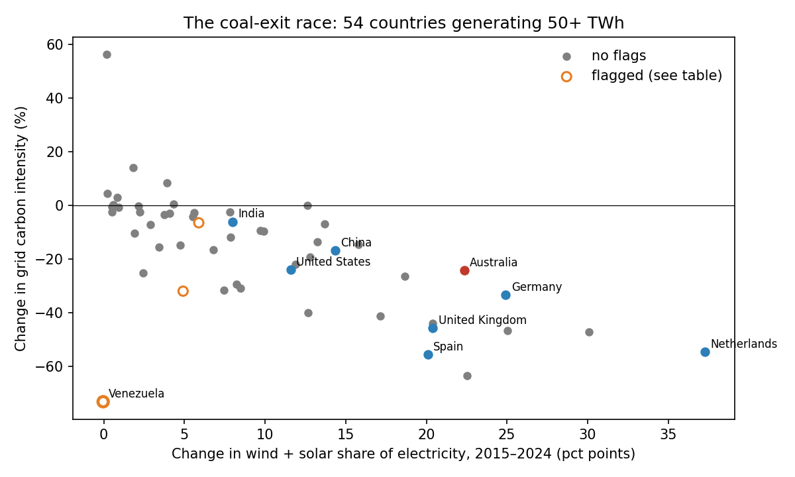
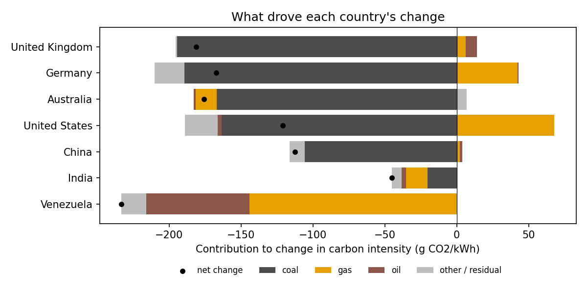

# The coal-exit race

Which large electricity grids cut their carbon intensity fastest between 2015 and 2024, what replaced the coal, and can the leaderboard be trusted?



## Findings

- **Australia cut grid carbon intensity 24%** (730 to 554 g CO2/kWh), ranking 18th of 54 grids generating 50+ TWh. Coal's share fell 19 points and solar alone added 15. Across 18 combinations of start year, end year and size cut-off, Australia always sits between the 19th and 33rd percentile, so "top third" is a fair summary while "18th" is not robust.
- **Wind and solar replaced coal about 3:1 over gas.** That's the average across the 21 countries that cut coal's share by 5+ points (+15.1 vs +4.8 points).
- **The raw leaderboard's winner is a data trap.** Venezuela tops it at −73%, but its total generation fell 37% and its clean generation fell too. Hydro's share jumped because thermal plants stopped running, not because anything was built. Two automated flags catch this. After flagging, the Netherlands is in the top five in 94% of analysis variants.
- **Cutting coal is not enough if gas fills the gap.** In the US, falling coal cut intensity by ~165 g/kWh, but rising gas added back ~70.



## Design decisions

| Decision | Why |
|---|---|
| Drop OWID's regional aggregates (World, Europe, income groups) | They sit in the same table as countries and would be double counted. |
| Fit emission factors from the data, then validate on held-out countries | The decomposition rests on intensity being roughly a weighted sum of fossil shares. Holding out whole countries (R² 0.86 vs 0.87 in-sample) shows the relationship generalises rather than memorising each country. |
| Decompose change into coal, gas and oil contributions plus a residual | The identity holds exactly by construction (tested). A large residual means shares don't explain the change, which is itself a warning. |
| Flag "shrinking, not cleaning" by checking clean generation in TWh | My first rule flagged any grid where generation fell 15%, which wrongly caught the UK and Germany. The real question is whether clean output grew, so the rule now tests that directly. |
| Re-run the ranking across 18 reasonable analysis choices | Start year, end year and size cut-off are judgement calls. A result is only quoted if it survives them. |
| Report ranks as percentiles in the sensitivity check | The number of countries changes with the cut-off, so raw ranks aren't comparable. |
| Pin the OWID data to a commit | OWID revises figures. Pinning keeps results reproducible. |

**Deliberately left out:** a regression with policy or price variables. With 54 countries and many confounders, it would invite causal claims the data can't support.

## Limitations

Production-based intensity ignores imports, so net importers can look cleaner than their consumption is. Fitted factors are averages; real plant efficiency varies by country. Flag thresholds (15% generation drop, 15-point hydro swing) are simple and stated openly.

## Run it

```bash
pip install -e ".[dev]"
pytest                        # 7 tests on synthetic data, no download needed
python -m coalrace report     # downloads OWID data, writes results/
python -m coalrace report --start 2010 --min-twh 20 --country "United Kingdom"
```

Data: [Our World in Data energy dataset](https://github.com/owid/energy-data) (pinned commit `f8de88a`).

## Layout

```
src/coalrace/
  data.py          load, drop aggregates, pinned source
  model.py         fit emission factors, held-out-country validation
  decompose.py     changes and coal/gas/oil attribution
  flags.py         "is this a real transition?" checks
  sensitivity.py   ranking across 18 analysis choices
  plots.py, cli.py
tests/             factor recovery, exact attribution identity, flag behaviour
```
